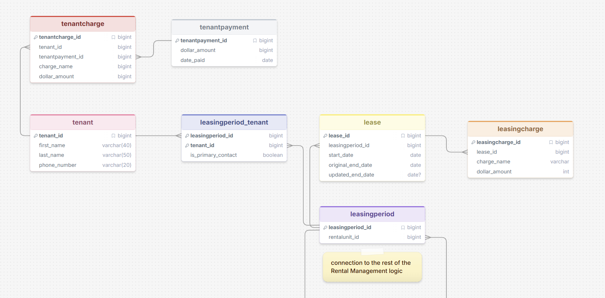
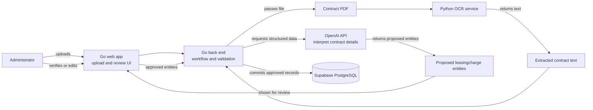

# Contract Converter: Project Design

## 1. Project purpose and goals

This project is an OCR middleman that turns rental contract PDFs into lease charge records that are ready for an administrator to review and add to a rental management app. It addresses a likely pain point for landlords: moving lease details from paper contracts and emailed PDFs into their software by hand.

The system will let an administrator upload a contract, extract its text with OCR, use the OpenAI API to interpret the relevant details as `leasingcharge` entities, and review those proposed entities in a web interface. After the administrator confirms the information, the app will save the records to Supabase PostgreSQL.

The goal is to make contract entry faster while keeping a human in control of the final database changes. This work will also connect to my larger rental management pet-project app and make it easier for landlords to bring existing leases into the system.

## 2. Initial ERD

The schema sketch below shows the rental data surrounding the contract conversion feature. The conversion flow will create proposed `leasingcharge` records associated with a `lease`; the administrator reviews them before they are committed. A lease is associated with a leasing period, and tenants are associated with leasing periods through the join table. The diagram also sketches tenant charges and payments and their relationship to the rest of the rental management app.

## 3. Rough system design

The Go application will provide the web interface and coordinate the workflow. A Python OCR component will extract text from uploaded PDFs. The Go back end will send that text to the OpenAI API to structure the relevant lease details into `leasingcharge` data. The admin reviews the proposed data in the web app, then the back end writes approved records to Supabase PostgreSQL.

## 4. Initial daily goals through the end of class

This is an initial sequence of daily milestones. I will map the later milestones to the remaining class days and use the final class day for a working demonstration.

| Day | Goal |
| --- | --- |
| 1 | Confirm the scope of the contract-to-`leasingcharge` workflow and review the existing rental schema. |
| 2 | Set up the Go upload and review flow, including a way to accept a contract PDF. |
| 3 | Build a small Python OCR component and verify that it can extract readable text from sample contracts. |
| 4 | Connect the Go back end to the OCR component and pass extracted text through the workflow. |
| 5 | Define the structured `leasingcharge` fields and connect the text-processing step to the OpenAI API. |
| 6 | Add parsing and validation so the app can display proposed charge records and flag missing or uncertain values. |
| 7 | Build the administrator review and edit screen; make approval an explicit step before saving. |
| 8 | Connect approved records to Supabase PostgreSQL and verify that they map to the intended lease. |
| 9 | Exercise the complete upload-to-review-to-save flow with sample PDFs, fix issues, and prepare a demonstration. |
| Final class day | Present the project purpose, ERD, system design, and working workflow; summarize what is complete and what could be added next. |
